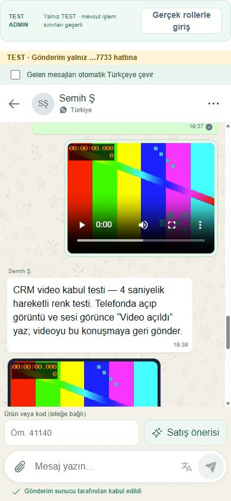
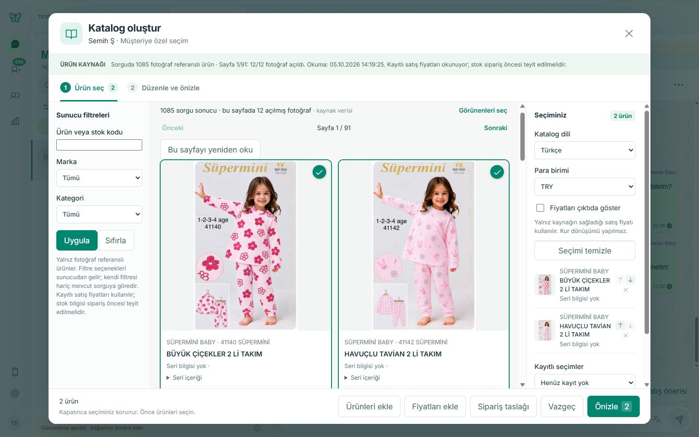
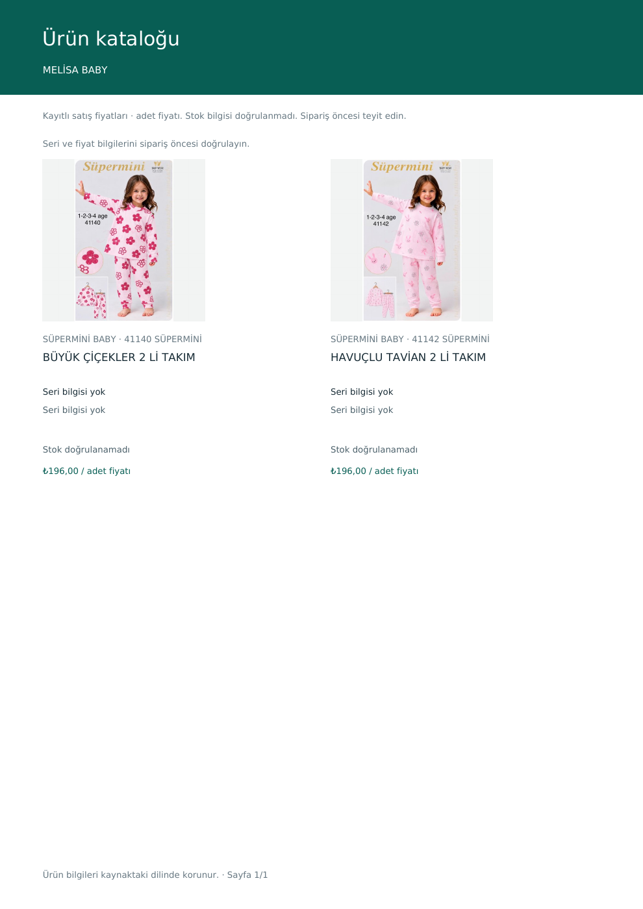
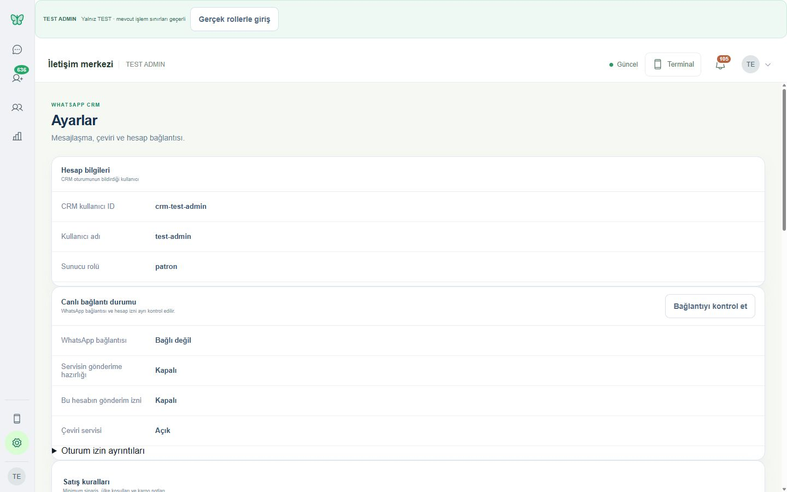

# CRM gerçek kullanım denetimi — 5 Ekim 2026

**Amaç:** mevcut CRM'yi satış personeli gibi kullanmak, korunacak iyi tarafları ve günlük işi aksatan yerleri kanıtla göstermek. Bu turda uygulama kodu, servis ayarı, paket veya teslim sırası değiştirilmedi; düzeltme, build, restart, main merge ve LIVE deploy yapılmadı. Kullanıcı bu private CRM reposunda ham müşteri ekranlarının denetim için saklanmasına açıkça izin verdi. Authentication secret, ham DOM, cookie, token, özel config ve imzalı dosya adresleri arşive alınmadı. Giriş ekranlarındaki parola alanları yalnız maskeli görünür; parola değerleri kaydedilmedi.

**TEST:** http://127.0.0.1:62400/ — görünür Chrome, TEST ADMIN. Masaüstü 1440, dar masaüstü 1024, mobil genişlik 390 piksel; son ekran normal 1920 genişliğe döndürüldü. Tam resim boyutları ve SHA256 değerleri [manifest.json](manifest.json) içinde. Mobil kayıtlar tarayıcı boyut denemesidir; fiziksel Samsung kabulü değildir.

**Genel izlenim:** sohbet, gerçek ürün fotoğrafları, katalog ve medya oynatıcıları kullanılabilir bir temel oluşturuyor. Ancak uzun görüşmenin geçmişine ulaşmak, kesintisiz gönderim ve AI'dan sonuç almak bugün güvenilir günlük kullanımın önünde. Ekranın sade yeşil dili korunmalı; teknik bilgi, tekrarlanan açıklamalar ve bazı büyük sabit alanlar satış işini yavaşlatıyor. Aşağıdaki öneriler uygulanmış karar değildir.

## Kanıtı nasıl okumalı?

- 🟢 **İyi / koru:** bu denetimde görülen olumlu davranış. Bütün modülün veya LIVE'ın kabul edildiği anlamına gelmez.
- 🟡 **Rahatsız edici / iyileştir:** sürtünme, eksik doğrulama veya kullanıcı kabulü bekleyen kapsam.
- 🟠 **Gereksiz / sadeleştir:** günlük satış ekranında fazla yer, tekrar veya teknik metin.
- 🔴 **Bozuk / kullanımı engelliyor:** bu denetimde işi durduran somut davranış.

Önceki [kabul kayıtları](../../../../USER_ACCEPTANCE.md), [finish tree](../../../../CRM_FINISH_PLAN.md) ve [tarihsel durum](../../../../CRM_STATUS.md) baseline olarak korunur. Önceden kabul edilmiş fotoğraf/PDF/TXT/ses/video, katalog/ürün/fiyat ve tek ürünlü 392 TRY ERP taslağı bu turdaki engeller yüzünden bütünüyle eksik sayılmadı. Ajan ekran provası, HTTP 200 ve geçmiş kabul birbirinin yerine kullanılmadı.

## Gerçek denetim sonucu

| Ekran / Akış | Ne denedim | Ne gördüm | İyi olan | Sorun | Öneri | Kanıt |
| --- | --- | --- | --- | --- | --- | --- |
| 🟢 / 🟡 Konuşma listesi | Terminal önizlemesinden normal yönetime geçtim; listede gezdim. | Normal masaüstünde liste ve sohbet yan yana; ilk terminal modu ekranın ortasında dar bir önizlemeydi. Bazı isimler WhatsApp + numara, bazı önizlemeler “Mesaj içeriği görüntülenemiyor”. | Sade renkler, okunur kişi satırları ve arama. | İsimsiz kişi ve boş içerik satışçının müşteriyi tanımasını zorlaştırıyor. Dar terminal önizlemesi normal masaüstü taşması değildir. | Bilinen müşteri adı ve anlaşılır medya önizlemesi öne alınabilir; mevcut liste düzenini koru. | [Terminal](desktop/01-inbox-1440.jpg), [Normal liste](desktop/02-management-inbox-1440.jpg) |
| 🟢 Arama / müşteri bulma | 7733 ile aradım; dar ekranda listeyi açtım. | Semih Ş'nin doğru konuşması ve +905387217733 müşteri bilgisi bulundu. | Telefonla hızlı arama ve listeye dönüş. | Bu filtre başka ekranlarda görünmeden etkisini sürdürüyor; aşağıdaki müşteri satırına bak. | Arama davranışını koru; etkin filtreyi ekranlar arasında görünür kıl. | [Sohbet](conversations/03-test-7733-chat-1440.jpg), [Mobil liste](mobile/10-search-list-390.jpg), [Kimlik](conversations/04-test-customer-info-1440.jpg) |
| 🟢 Gelen / giden metin | Yalnız 7733'e A01 mesajı gönderdim; kullanıcı İngilizce yanıt verdi. | Giden mesaj 13:58 balonunda; “Hello, can you send the catalog and price?” gelen mesajı 14:01 etiketiyle CRM'de görüldü. Kullanıcı “Yanıtladım” dedi. | Doğru kişiyle çift yönlü gerçek yazışma gerçekleşti. | Denetimin sonunda gönderim kapandı; bu başarı sürekli çalışma garantisi değil. Gelen mesajı 14:09'da gördüm; bu sekiz dakika aktarım gecikmesi kanıtı değildir, arada başka ekranlar incelendi. | Bu gerçek kabul kanıtını koru; son durumdaki kesintiyi ayrıca ele al. | [A01](conversations/06-sent-message-1440.jpg), [Gelen yanıt](translation/16-incoming-english-turkish-1440.jpg) |
| 🟢 / 🟡 Mesaj taslağı / uzun metin | 477 karakterli metni yazdım; Ayarlar → Mesajlar yaptım. | Metin ve satır sonları birebir korundu; başarısız gönderimde de taslak kaldı. | Yazılan metin kaybolmadı. | Uzun kutu, sabit AI satırı ve “son mesaja git” kontrolü konuşma alanını daraltıyor. | Metin korunmasını değiştirmeden, yardımcı kontrollerin kapladığı alanı değerlendirin. | [Uzun taslak](conversations/13-long-message-draft-1440.jpg), [1024](desktop/07-chat-1024.jpg), [390](mobile/09-stable-chat-390.jpg) |
| 🔴 Gönderim / bekleme | A02 uzun metni göndermeyi denedim; sonra kataloğu ve TEST ADMIN dönüşünü kullandım. | Gönderimde 429 ve yaklaşık 370 sn bekleme; katalogda da 265 sn bekleme, daha sonra TEST ADMIN'de 43 sn engel. Süre bitince normal dönüş çalıştı. | Hata görünür; taslak korunuyor. | Bir istek sınırı birden fazla işi durduruyor. Saatlerce kullanım için kabul edilebilir değil. | Sonraki geliştirmede okumaların ve gönderimin birbirini durdurması dar kapsamda ele alınmalı; bu turda limit/ayar değiştirilmedi. | [Gönderim 429](translation/17-translation-and-send-rate-limit-1440.jpg), [Katalog 429](catalog/19-catalog-rate-limit-1440.jpg), [Giriş 429](desktop/29-test-admin-rate-limit-1440.jpg) |
| 🔴 Konuşma geçmişi | 7733 geçmişinde medya ve yeni mesajlar arasında gezdim. | İlk görülen eski fotoğraf, sonraki yenilemede erişilebilir mesaj grubundan çıktı; eski mesaj yükleme kontrolü bulunamadı. Kaynak son 20 mesajı gösteriyor. | Son mesajlar okunur; sona atlama mevcut. | Uzun müşteri görüşmesinin önceki bölümüne ekrandan ulaşılamıyor. Verinin silindiği kanıtlanmadı. | Üstten eski mesaj yükleme veya açık tarihli geçmiş erişimi değerlendirilmeli. | [İlk geçmiş](conversations/03-test-7733-chat-1440.jpg), [Sonraki geçmiş](conversations/05-send-result-before-latest-1440.jpg); kaynak doğrulaması aşağıda |
| 🟢 / 🟡 Otomatik çeviri | 7733 gelen İngilizce mesajında Türkçe çeviriyi açtım. | “Merhaba, katalog ve fiyatı gönderebilir misiniz?” sonucu; İngilizce asıl mesaj korunuyor, dil en olarak algılandı, çeviri gizlenebiliyor. | Asıl metin ve çeviri birlikte okunabilir; gerçek gelen mesajda çalıştı. | Çeviri kutusu mesaj altını uzatıyor; sabit yazma alanı nedeniyle aşağıda kalabiliyor. Bu turda yeni giden çeviri gönderilmedi. | Kısa çevirinin görünürlüğü ile uzun görüşmenin yer ihtiyacı için karar verin. | [İngilizce / Türkçe](translation/16-incoming-english-turkish-1440.jpg), [Yerleşim ve bekleme](translation/17-translation-and-send-rate-limit-1440.jpg) |
| 🟡 Fotoğraf | 32 KB TEST PNG dosyasını dosya menüsünden seçtim; önizleme açıldı. | Küçük önizleme ve kaldırma var; son denemede gönder düğmesi kapalı. Bu beyaz ağırlıklı test görselidir. | Dosya seçme ve gönderim öncesi kontrol mevcut. | Yeni fotoğraf gönder/al tamamlanmadı; fotoğraf büyütme bu turda doğrulanmadı. | Önizleme daha rahat incelenebilir; yeni gerçek fotoğraf kabulü bağlantı engeli çözüldükten sonra aynı kapsamda yapılmalı. | [Önizleme](media/18-photo-preview-1440.jpg), [Gönderim kapalı](media/43-photo-send-disabled-1440.jpg) |
| 🟢 / 🟡 PDF / TXT / dosya | Önceden kabul edilmiş gelen PDF ve TXT bağlantılarını indirdim ve dosyaları okudum. | PDF 1784 bayt / bir sayfa; TXT 67 bayt; ikisi de açılabilir TEST içeriği. | Gerçek sohbet dosyasına erişim ve indirme çalıştı. | “Dosya 2 KB / 1 KB” bağlantısı tür ve dosya adını zayıf anlatıyor. Yeni karşılıklı dosya gönderimi yapılmadı. | Dosya türü, özgün ad ve boyut birlikte gösterilebilir; indirme davranışı korunmalı. | [Dosya balonları](conversations/05-send-result-before-latest-1440.jpg) |
| 🟢 Ses | Kabul edilmiş gelen ses kaydını oynattım. | Oynatıcı yaklaşık 3,03 sn sonunda ended=true, error yok. | Tarayıcı oynatıcısı ve sohbet içinden dinleme çalışıyor. | Yeni ses gönderimi bu turda yok; fiziksel telefonda yeni kabul yok. | Mevcut oynatıcıyı koru; son durumla eski kabulü karıştırma. | [Ses oynatıldı](media/11-incoming-audio-played-1440.jpg) |
| 🟢 Video | Kabul edilmiş gelen videoyu oynattım. | Yaklaşık 4,02 sn sonuna ulaştı, error yok; görüntü oynatıcıda görüldü. | Sohbet içinde video açılıyor. | Yeni video gönderimi bu turda yok. | Mevcut video davranışını koru. | [Video oynatıldı](media/12-incoming-video-played-1440.jpg) |
| 🟡 / 🔴 Atanmamışlar | Havuzu, müşteri ekranını ve ekip özetini karşılaştırdım. | Havuz/menü 636; ekip özeti 19 gösteriyor. İlk sayfa ile bütün yüklü listenin sayıları ayrı hesaplanıyor. | Havuz görünür; hızlı atama yolu var. | Satışçı doğru bekleyen iş sayısını anlayamıyor. 19 demo sabiti değil; farklı kapsamda hesaplanan gerçek sayıdır. | Aynı kapsam ve güncelliği ifade eden tek sayı kullanılmalı. | [Havuz](desktop/24-unassigned-1440.jpg), [Ekip özeti](desktop/22-team-dashboard-1440.jpg) |
| 🟡 Atama | 7733 konuşmasındaki Temsilci ata penceresini açtım; değişiklik yapmadan kapattım. | Beş gerçek personel seçeneği ve işlem kontrolü göründü. | Atama sohbet menüsünden erişilebilir. | Bu turda kayıt değiştirilmedi ve personelin kendi ekranında görünüm doğrulanmadı. | Mevcut atama kabulünü koru; doğru personel/rol ekranı kalan kullanıcı kabulüdür. | [Atama penceresi](conversations/20-assignment-dialog-1440.jpg) |
| 🟡 Müşteri bilgileri | 7733 ve başka bir gerçek müşteriyi salt okunur açtım; 1024 paneli inceledim. | Telefon, ülke etiketi ve temsilci paneli; gerçek uzun satış talebi görüldü. | Müşteri/konuşma bağlantısı anlaşılır. | 7733 araması ardından Müşteriler ekranında toplam 743 / görünen 1; etkin arama burada görünmüyor. | Gizli filtre ve boşluk hissini giderecek görünür filtre özeti değerlendirilmeli. | [Filtreli müşteri](desktop/21-customers-filtered-1440.jpg), [Bilgi paneli](conversations/26-real-customer-info-1440.jpg), [1024](desktop/27-customer-panel-1024.jpg) |
| 🟢 / 🟡 Gerçek müşteri görüşmesi | Fas etiketli, sonu 6572 olan müşterinin uzun ürün/MOQ/kargo/ödeme talebini okudum. | Gerçek ticari mesaj okunuyor; bazı eski satırlar içeriksiz gönderen satırı olarak görünüyor. | CRM yalnız bir demo konuşma göstermiyor. | Bütün diğer kişilerin yeni mesaj alımı kanıtlanmadı; telefon ülkesinden teslimat ülkesi çıkarılmamalı. | Uzun metin ve medya önizlemesini iyileştirme kararı alınabilir. | [Salt okunur görüşme](conversations/25-real-customer-readonly-1440.jpg) |
| 🟢 / 🟠 Ekip / özet | Masaüstü ve mobilde ekip ekranını açtım. | Gerçek personel ve kartlar; geniş dikey kart alanları ve tutarsız havuz sayısı. | Ayrı ekip görünümü faydalı. | Büyük özet alanları, günlük satış işine göre fazla yer kullanıyor. | Kart yoğunluğu ve görünmesi gereken 2–3 temel ölçüt için karar verin. | [1440](desktop/22-team-dashboard-1440.jpg), [390](mobile/23-team-dashboard-390.jpg) |
| 🟢 / 🟡 Katalog | Dosya menüsünden Katalog oluştur; gerçek kartlar, filtreler ve iki ürün seçimi. | Mevcut ERP/Vega okuma yolundan fotoğraflı ürünler; kaynakta 1085 ürün, ilk görünümde 12/12 fotoğraf açıldı. | Gerçek ürün fotoğrafı, kart seçimi, arama ve dil/para birimi kontrolü. | Katalog girişinin dosya menüsü içinde olması keşfi zorlaştırıyor. Bu mevcut okuma yolu ERP-D05 yeni sözleşmesinin kabulü değildir. | Katalog girişinin daha görünür olması gerekip gerekmediğine karar verin; yeni ticari veri kopyası oluşturmayın. | [Katalog](catalog/31-catalog-default-usd-1440.jpg), [İki ürün](catalog/32-catalog-two-products-try-1440.jpg) |
| 🟢 Ürün arama / fotoğraf | Mobilde kod 41140 ile filtre uyguladım; önceki iki seçimi kontrol ettim. | Doğru tek sonuç; seçilen iki ürün korunuyor; gerçek fotoğraflar açılıyor. | Filtreleme, seçim devamlılığı ve fotoğraf kartları iyi. | Dar ekranda açılan filtre ve alt işlem alanı ürünler için kalan yüksekliği azaltıyor. | Başlangıçta kapalı mobil filtreyi koru; seçim özeti/alt alan yoğunluğunu değerlendirin. | [Mobil katalog](mobile/34-catalog-390.jpg), [Kod arama](mobile/35-catalog-code-search-390.jpg) |
| 🟢 / 🟡 Fiyat / para birimi | USD varsayılanını gördüm, TRY seçtim ve iki üründe fiyatı açtım. | 41140/41142 için kayıtlı 196 TRY/adet; USD fiyatı yoksa sayı uydurulmuyor. Başka bir kartta gerçek USD fiyatı var. | Para birimi açık, eksik fiyat dürüstçe belirtiliyor; otomatik kur çevrimi yok. | Kullanıcı TRY ürünü için önce USD boşluğunu görüp seçimi değiştiriyor. | Para birimi varsayılanı veya müşteri bazında hatırlama kullanıcı kararı olmalı. | [USD](catalog/31-catalog-default-usd-1440.jpg), [TRY](catalog/32-catalog-two-products-try-1440.jpg) |
| 🟡 Ürün / fiyat gönderme | İki ürün seçtim; ürün/fiyat ekleme ve sohbet paylaşma yollarını inceledim. | Kontroller ve önizleme hazır; önceki konuşmada fiyat/katalog telefon kabul mesajları var. | Kullanıcı ne gönderileceğini görerek ilerliyor. | Bu turda yeni ürün/fiyat mesajı gönderilmedi; son gönderim engeli var. Önceki kabul yeni deneme sonucu değildir. | Gönderim engeli ayrı işte çözülünce yalnız değişen paylaşım kapsamını dene; önizlemeyi kaldırma. | [Seçim / işlemler](catalog/32-catalog-two-products-try-1440.jpg), [Önizleme](catalog/37-catalog-preview-1440.jpg), [Son engel](desktop/44-settings-send-disabled-1440.jpg) |
| 🟢 / 🟠 Katalog PDF | İki ürünü TRY ve fiyat göster seçimiyle önizledim, gerçek PDF indirdim; dosyayı açıp sayfayı çizdirdim. | Bir sayfalı PDF, iki gerçek fotoğraf ve 196 TRY/adet; indirme 133596 bayt. | Gerçek çıktı oluşuyor; mobilde de önizleme var. | Seri bilgisi yok açıklaması birkaç kez tekrarlanıyor; stok/seri doğrulanmış değil; sayfada fazla boşluk var. | Eksik bilgi etiketini koru; tekrarları ve boşluğu sadeleştirme kararı alın. | [Ekran](catalog/37-catalog-preview-1440.jpg), [Mobil alt bölüm](mobile/36-catalog-preview-390.jpg), [Gerçek PDF](catalog/38-generated-two-products-TRY.pdf), [Çizdirilen sayfa](catalog/38-generated-pdf-page.png) |
| 🟡 ERP taslak sipariş | Mevcut izinli müşteri 593, ürünler 41140/41142; ERP TEST girişinden sonra 2 ve 3 adet girdim, kaydetmeyi denedim. | Form ve geçerli miktarlar; fakat sonuç/readback veya açık hata görülmedi. Sonra CRM başlangıç ekranına döndü; aynı zaman diliminde süreç değişimi ve auth401 görüldü. | Ayrı ERP giriş sınırı ve açık TEST taslak formu; gerçek ürün/fiyat, sentetik TEST müşteri. | Yeni taslak sonucu doğrulanamadı. 980 TRY yalnız beklenen hesap; oluşturulmuş sipariş tutarı diye yazılamaz. Genel müşteri eşleme hazır değil. | Mevcut pending işlem kimliği kontrol edilmeden tekrar oluşturma yapmayın. Sonraki yetkili işte ayrı ERP readback ile sonucu kesinleştirin. | [ERP giriş](erp-order/39-erp-login-1440.jpg), [Mobil form](mobile/40-erp-draft-form-390.jpg), [Kaydetmeden önce](erp-order/41-erp-draft-before-save-1440.jpg), [Başlangıca dönüş](desktop/42-test-admin-opening-after-delay-1440.jpg) |
| 🔴 / 🟡 AI satış yardımcısı | Yalnız konuşma 55/7733, mevcut izinli anahtar; ürün kodu 41140 ile öneri istedim. | Tamamlanan UI denemesi öneri yerine genel hata verdi. Güvenli log metadata'sı: 14:18:45.911, HTTP502, AI_PRICE_PROSE_FORBIDDEN. | İnsan kontrollü öneri yaklaşımı korunuyor; gerçek müşteriye otomatik gönderim yapılmadı. | Bu denemede kullanıcıya kullanılabilir yanıt önerisi gelmedi; hata satışçıya neden/ne yapmalı bilgisini vermiyor. Modelin ham cevabı incelenmedi; hangi cümlenin reddedildiği bilinmiyor. | Kaynak doğrulamalı ürün/fiyat kartlarını ve anlaşılır öneri hatasını değerlendirin; fiyat kontrolünü kendiliğinden gevşetmeyin. | [AI başarısız](ai/30-sales-suggestion-failed-1440.jpg) |
| 🟡 AI ticari kurallar | Ayarlardaki MOQ/ülke/kargo/satış notlarını okudum. | MOQ henüz belirlenmedi, ülke kuralı yok, diğer alanlar boş. | Numara/dilden otomatik teslimat ülkesi seçilmiyor; fiyat/kargo uydurmama yaklaşımı doğru. | Kod ve boş form işletmenin gerçek kuralları hazır demek değil. | Kullanıcı ticari kuralları belirlemeli; Codex bu alanları varsayımla doldurmamalı. | [Ayarlar](desktop/14-settings-1440.jpg), [Mobil](mobile/15-settings-390.jpg) |
| 🟢 / 🟡 TEST ADMIN / gerçek roller | Normal TEST'i açtım; gerçek rollerle giriş formuna geçtim, TEST ADMIN'e döndüm. | Normal form ve otomatik TEST ADMIN çalıştı; 429 bitene kadar dönüş engellendi. Normal CRM rol girişini bu turda göndermedim. | Şifreyi tekrar istemeden TEST gezilebiliyor; normal giriş yolu korunuyor. | Sanal patron TEST ADMIN, gerçek patron/müdür/personel kabulü değildir. Giriş görüntüsünde tarayıcı doldurması ve maskeli parola var, parola değeri arşivde yok. | Gerçek üç rol ve doğru personel kapsamı mevcut kullanıcı kabulünde ayrıca doğrulanmalı. | [Giriş formu](desktop/28-real-role-login-1440.jpg), [Geçici giriş engeli](desktop/29-test-admin-rate-limit-1440.jpg) |
| 🟠 / 🔴 Ayarlar / bağlantı | Başlangıç ve son bağlantı durumunu karşılaştırdım; son aşamada normal bağlantı kontrolü ve izin yenilemeyi birer kez denedim. | Başta bağlı/gönderim açık; sonda Bağlı değil, hazırlık Kapalı, hesap gönderimi Kapalı; çeviri Açık. Erişilebilirlik metnindeki alt kart yine “Gelen bağlı” diyor. | Bağlantı ve hesap iznini ayrı göstermesi faydalı. | Gönderim gerçekten kapalı; detay durumu ile alt genel kart çelişiyor. Büyük kullanıcı ID/rol alanları günlük işi geri plana itiyor. | Tek güncel durum kaynağı ve isteğe bağlı hesap ayrıntıları değerlendirilmeli. Kapalı gönderimi bu turda ayar değiştirmeden kaydettim. | [Başlangıç](desktop/14-settings-1440.jpg), [Son kapalı durum](desktop/44-settings-send-disabled-1440.jpg), [Normal boyuta dönüş](desktop/45-settings-end-state-1920.jpg) |
| 🟡 Masaüstü / mobil kullanım | Aynı sohbet, katalog, müşteri ve ERP formunu 1440/1024/390 genişliklerde gezdim. | Mobil liste/sohbet geçişi, iki sütun ürün kartları ve miktar formu kullanılabilir; 1024 katalogda birden fazla kaydırma alanı var. | WhatsApp benzeri balonlar ve büyük temel kontroller; mobil filtreler başlangıçta kapalı. | Sabit yazma/AI ve alt katalog alanları dar yüksekliğin büyük bölümünü tüketiyor. Fiziksel telefon ve uzun günlük kullanım bu turda kabul edilmedi. | İyi mobil kart düzenini koru; kalıcı yardımcı alanların yüksekliği için karar verin. | [Sohbet 1024](desktop/07-chat-1024.jpg), [Sohbet 390](mobile/09-stable-chat-390.jpg), [Katalog 1024](catalog/33-catalog-1024.jpg), [Katalog 390](mobile/34-catalog-390.jpg) |
| 🟡 Restart / autostart | Hiç restart yapmadım; denetim esnasındaki başlangıç ekranı ve süreç kimliğini salt okunur karşılaştırdım. | TEST süreci 68744 → 50916 değişti; yeni başlangıç 14:27:53.164. Paket/source aynı; native ERP süreci aynı. Eski CRM token401 oldu, normal reload sonrası TEST ADMIN açıldı. | Normal TEST tekrar açılabiliyor. | Süreç değişiminin sebebi/kimin yaptığı ve Windows logon kabulü doğrulanmadı; ERP denemesinin sonucu belirsiz kaldı. | Başlangıç sürekliliği ve kesilmiş işlem sonucu ayrı işte incelenmeli; bu gözlem autostart PASS değildir. | [Başlangıç ekranı](desktop/42-test-admin-opening-after-delay-1440.jpg), [Son ekran](desktop/44-settings-send-disabled-1440.jpg); güvenli kimlik kaydı aşağıda |

## 7733 ile gerçekte neler oldu?

1. **Bir doğrulanmış yeni giden metin:** A01, 13:58. Kullanıcı bu konuşmaya yanıt verdiğini belirtti; İngilizce yeni gelen metin CRM'de görüldü. Başka müşteriye gönderim yok.
2. **Gerçek yeni gelen mesajın Türkçe çevirisi** ve İngilizce aslı görüldü. Gelen mesaj saati 14:01, denetçi gözlemi yaklaşık 14:09; aktarım gecikmesi ölçülmedi.
3. **477 karakter taslak** ekranlar arası korundu. A02 gönderme denemesi 429 ile başarısız; başarılı gönderim sayısına eklenmez.
4. **Önceden kabul edilmiş** gelen PDF/TXT indirildi; ses/video oynatıldı. Bu turda yeni karşılıklı fotoğraf/PDF/TXT/ses/video gönderimi tamamlanmadı. Fotoğraf yalnız önizleme; son düğme kapalı. Denetçinin gönderilmemiş A02/A03 taslak/ekleri temizlendi.
5. **Gerçek ERP ürünleriyle iki ürünlü katalog PDF** oluşturuldu ve indirildi. PDF/ürün/fiyat bu turda WhatsApp'a yeniden gönderilmedi; önceki telefon kabulleri ayrı baseline'dır.
6. **AI önerisi sonuç üretmedi.** Önceden verilen mevcut anahtar kullanma izni yalnız 55/7733 için kullanıldı; başka müşteri model çağrısı yok. İlk yükleme sırasındaki tıklama ardından bir tamamlanan UI öneri denemesi var; kesin provider/model çağrı sayısı ölçülmedi. Hiç AI otomatik gönderimi yok.
7. **ERP iki ürünlü taslak denemesi doğrulanamadı.** Sentetik TEST müşteri 593 ve gerçek eşli ürünlerde 2+3 adet girildi. Ayrı sipariş readback/SQL sonucu yok; oluştu veya oluşmadı denemez. İşlem körlemesine tekrar edilmedi.

Diğer gerçek görüşmelerde yalnız okuma yapıldı: mesaj, atama, AI, ERP veya ticari veri değişikliği uygulanmadı. Otomatik Türkçe çeviri başka gerçek görüşmelere geçmeden kapatıldı; denetim sonunda da kapalı bırakıldı. Tarayıcı boyut override'ı kapatıldı ve CRM sekmesi açık bırakıldı.

## Gerçek veri, demo veri ve AI sınırı

| Alan | Bugünkü gerçek |
| --- | --- |
| Konuşmalar | Chatwoot'taki gerçek müşteri kayıtları ve 7733 WhatsApp yazışması okunuyor; bütün kişilerin yeni alımı bu turda kanıtlanmadı. |
| Katalog | Mevcut ERP/Vega read bağlantısından ürün/fotoğraf/kayıtlı fiyat; 41140 ve 41142 gerçek ürünler. Yeni ERP-D05 sözleşme geçişi yapılmadı. |
| Fiyat | Her iki seçili üründe 196 TRY/adet; USD eksikse fiyat uydurulmuyor. Stok/seri satış garantisi doğrulanmış değil. |
| ERP taslak müşteri | 593 / TEST-V70-20260929-C sentetik, izinli TEST fixture. Gerçek müşteriye otomatik ERP eşleme veya sipariş yok. |
| Medya | PDF/TXT/oynatılan ses/video ve seçilen PNG bilinçli TEST içerikleridir; normal katalog ürünleri sentetik değildir. |
| TEST ADMIN | Yalnız TEST'e ait sanal patron; gerçek personel oturumu değildir. |
| AI | İnsan tarafından istenen öneri; gerçek katalog/fiyat bağlamı mevcut, bu canlı deneme fiyat metni kontrolünde reddedildi. Kullanılabilir yanıt veya yeni AI ürün/fiyat önerisi bu turda gösterilemedi. MOQ/ülke/kargo kuralları henüz doldurulmamış. |
| Otomatik işlem | İncelenen config autoReply=false; başka gerçek müşteriye otomatik satış yanıtı bu denetimde yapılmadı. Bu ifade bütün sistemler için evrensel teknik imkânsızlık iddiası değildir. |

## Çalışan kaynak ve kesinti kaydı

| Kimlik | Doğrulanmış değer / sınır |
| --- | --- |
| Kanonik repo | C:\Sirket\CRM\melisa-crm; origin https://github.com/melihsnyldzz-ui/melisa-crm.git; GitHub repo private. |
| Kaynak checkout başlangıcı | codex/crm-agents-on-completion-20261003 / 8549b42bef07f67cf73cc63155b115ccdb5c5750; uygulama dalı ve yerel çalışma korunur. |
| Bu arşiv dalı | codex/crm-usage-audit-20261005; başlangıç 8549b42. PR aynı uygulama dalını base alır; main'e uygulama farkları taşınmaz. |
| CRM TEST UI / gateway | 62400 / 62401; paket C:\Sirket\CRM\releases\crm-test-f1899b0e0828f23010af75b1731682c749e596cc. |
| Çalışan CRM source | f1899b0e0828f23010af75b1731682c749e596cc; manifest SHA256 152fb6fc89b24493dfced026b594c858addee37f952ff64c7c1f5a36e3d7ea3a. Belge HEAD'i runtime source değildir. |
| CRM süreç değişimi | Başlangıçta PID68744; sonra PID50916, 14:27:53.164 TR. Yeni entrypoint aynı pakette deploy/test-server.mjs; startup PackageRoot ve manifest source aynı. Neden doğrulanmadı; denetçi restart yapmadı. |
| ERP katalog / adapter / native | 62402 / 62403 / 62404. Ayrı native PID49220 ve 10:05:23 başlangıcı korunuyor. Chatwoot mevcut gateway okuma bağlantısıyla gerçek mesaj kaynağı; Chatwoot servisi yeniden başlatılmadı. |
| Native ERP TEST | CRM-ORDER-DRAFT-TEST-20261005-04 / b708f8e0e6af17d473836a9d4b61c1f970c5bdb4; CANONICAL_TEST, crm-order-draft-only; DB MELISA_ERP_SIRKET_TEST_20260929_01. Health kimliği yeni sipariş kabulü değildir. |
| Son gönderim durumu | 14:33 ve 14:41 normal ekranda Bağlı değil / hazırlık Kapalı / hesap Kapalı. Config sendEnabled ve liveSendApproved true; bu mevcut provider readiness'in hazır olduğu anlamına gelmez. Kesin kapalı olma nedeni ayrıştırılamadı. |
| ERP denemesi / log sınırı | 14:23:50 ERP auth200; formdan kaydetme denemesi sonrası sonuç yok. 14:27:58–14:28:57 CRM auth401; zaman birlikteliği var, kesin sipariş hata nedeni kanıtlanmadı. Logda order kaydı görülmemesi DB'de hiç oluşmadığını kanıtlamaz. |
| LIVE | Bu görevde okunarak yeni LIVE kimlik/kabul araştırması yapılmadı; LIVE'a deploy/mesaj/restart/ayar değişikliği yok. |

### Kaynakla desteklenen açıklamalar

Bu bölüm kullanıcı ekranındaki sonucu açıklamak için salt okunur kaynak incelemesidir; uygulama değişikliği değildir. Bağımsız explorer ve reviewer ekran/kaynak bulgularını karşılaştırdı.

- Geçmiş: [chatwootInboxService.js](../../../../apps/gateway/src/services/chatwootInboxService.js) mesaj detail okumasında son 20'yi alır; [App.jsx](../../../../apps/frontend/src/App.jsx) detail yenilemesi görünür mesajları değiştirir, eski mesaj yükleme yolu bulunmadı. Sohbet verisinin silindiği iddia edilmez.
- Bekleme: [security.js](../../../../apps/gateway/src/middleware/security.js) gateway genel IP bütçesi, runtime güvenli seçili alanında 300/15 dk; kaynak varsayılanı 2000/15 dk'dır, bu TEST'te seçili runtime değeri geçerlidir. [requestControl.js](../../../../apps/frontend/src/requestControl.js) bir 429 sonrası ortak bekleme uygular. Birden fazla sekmenin katkısı olasıdır, gerçek tüketim ölçülmedi. Ayarlar değiştirilmedi.
- Sayılar/filtre: [liveApi.js](../../../../apps/frontend/src/liveApi.js) ilk sayfa havuz sayısı fallback'i ile App bütün liste hesabı farklı; paylaşılan arama state'i müşteri ekranını da filtreliyor.
- AI: [agent.mjs](../../../../apps/gateway/src/services/salesAgent/agent.mjs) kayıtlı katalog varken yanıtta veya Türkçe özette sayısal fiyat metnini reddedebilir. Log kodu bunu gösterir; ham model yanıtı okunmadı, credential hatası diye sunulmaz.
- Gönderim readiness: [crmAuthService.js](../../../../apps/gateway/src/services/crmAuthService.js), [waapiReadiness.js](../../../../apps/gateway/src/services/waapiReadiness.js) ve [waapiProvider.js](../../../../apps/gateway/src/providers/waapiProvider.js) bağlantı/readiness/güncellik şartlarını birleştirir. Kaynakta açık send ayarı, ekrandaki güncel gönderim iznini tek başına kanıtlamaz.

Yukarıdaki kaynak bağlantıları bu PR'nin kaynak atası içindir; uygulama dalına daha sonra gelen düzeltmeler bugünkü ekran kanıtını değiştirmez. Çalışan paket f1899b0 kimliği ayrıca korunur. Gizli runtime config veya ham log dump'ı Git'e eklenmedi.

## Finish tree ve sonraki iş sınırı

Arşiv öncesindeki tek finish tree **25 madde: 12 🟢, 12 🟡, 1 🔴; 13 tamamlanmamış** idi. Bu tur kullanıcı kabullerini veya teslim sırasını değiştirmedi; ağaca yeni geliştirme kararı eklemedi. Bu eski sayım bugünkü gönderim/AI/geçmiş sorunlarının kapalı olduğu veya LIVE hazır olduğu anlamına gelmez. Yeni bulgular bu rapor ve CRM_STATUS'ta, öncelik kararı bekleyen denetim kaydıdır.

Somut kullanım engelleri: son anda kapalı gönderim, yaygın 429 beklemesi, erişilemeyen eski sohbet geçmişi, sonuç üretmeyen AI önerisi. Ayrıca iki ürünlü ERP denemesi sonuçsuz/belirsiz; gerçek roller, personel görünümü, fiziksel mobil ve Windows logon kullanıcı kabulü açık. Önceki tek ürünlü ERP ve medya kabulleri yeniden açılmadı.

Bu rapor sonrası **durulur**. Otomatik bug düzeltme veya yeniden tasarım başlatılmaz; [teslim panosundaki](../../../../DELIVERY_BOARD.md) hedefler yeniden sıralanmaz.

## Karşılaştırma için temsilî görüntüler

Sohbetin dar ekran davranışı:

Gerçek ürünler ve kayıtlı TRY fiyat:

Yeni katalog dosyasının gerçekten açılan sayfası; bu görüntü CRM ekranı değil PDF render'ıdır:

Denetimin sonunda kapalı gönderim:

Manifestte 08 numara yoktur: ilk mobil yakalamada eski masaüstü karesi kaldığı için geçersiz görüntü arşivden çıkarıldı. 09 stabil mobil görünüm esas alınır. 42 başlangıç ekranının boyutu 1440 genişlikte diğer karelerden kısa olabilir; geçiş anıdır. 28/39 giriş ekranları maskeli form görüntüsüdür; boş form veya başarılı gerçek rol girişi diye sunulmaz. 36 mobil katalog görüntüsü aşağı kaydırılmış önizleme bölümüdür. 17, başarılı ikinci gönderim değil 429 engelidir. Dosya mtime zamanı kayıt zamanıdır; asıl mesaj saatiyle veya provider teslim anıyla aynı sayılmaz. Son 45 görüntüsü normal 1920 genişliktir.

## KULLANICI + CHATGPT KARARI GEREKİYOR

1. Önce hangi kullanım engelini ele alalım: gönderim sürekliliği/429, eski geçmiş erişimi, AI sonucu veya belirsiz ERP işlemi? Bu rapor öncelik sırasını değiştirmiyor.
2. Türkçe çeviri her mesajın altında açık mı kalsın, kısa özet + açılır ayrıntı mı olsun?
3. Mobilde AI öneri alanı sürekli açık mı dursun, yalnız istendiğinde mi açılsın?
4. Katalog için sohbetten doğrudan görünen bir kısayol gerekli mi; mevcut dosya menüsü yeterli mi?
5. Para birimi varsayılan USD mi kalmalı, kullanıcı tercihi veya müşteri bazında mı hatırlanmalı?
6. Stok/seri eksikliği uyarılarını nerede tek kez gösterelim; kart ve PDF tekrarlarını ne kadar azaltalım?
7. Müşteri/ekip ekranında öncelikle hangi bilgiler görünmeli; hesap ID/rol ve teknik bağlantı ayrıntıları açılır alana mı taşınmalı?
8. Ürün/fiyat paylaşımında önizlemeyi koruyarak kaç adım hedefleyelim; AI'ya verilecek gerçek MOQ/ülke/kargo kurallarının ilk kapsamı ne olsun?
