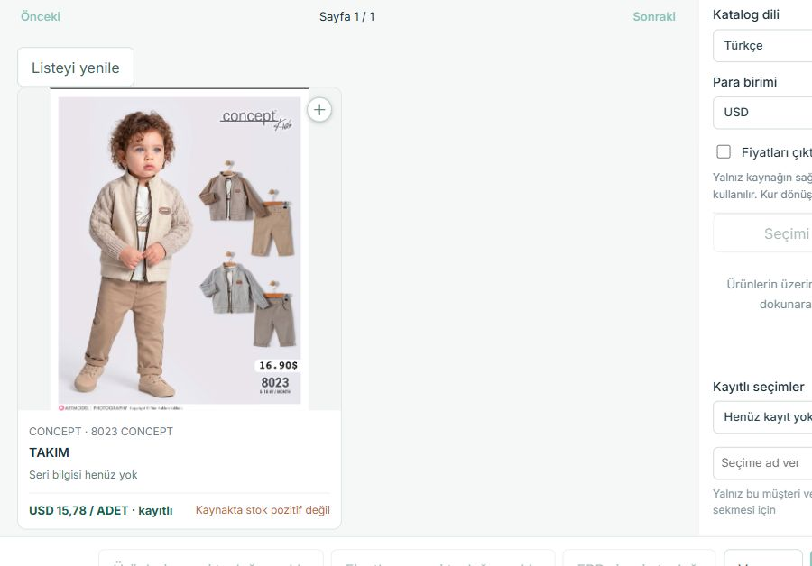

# Katalogda özgün fotoğraf — 10 Ekim 2026

Kullanıcı, 8023 CONCEPT ürününün doğru olduğunu kabul etti fakat katalog fotoğrafını bulanık buldu. Aynı normal TEST kataloğunda arama ve fotoğraflı ürün filtresi korunarak sorun düzeltildi. Yeni fotoğraf netliği için kullanıcı kabulü henüz alınmadı; aşağıdaki sonuç gerçek tarayıcı teknik kanıtıdır.

| Kontrol | Önce | Sonra |
| --- | --- | --- |
| 8023 CONCEPT / TAKIM | 103 × 128 thumbnail | 1206 × 1500 özgün JPEG |
| Karttaki fotoğraf alanı | 349 × 349 | 349 × 349; tasarım değişmedi |
| Arama sonucu | Aynı ürün | 1 ürün; fotoğraflı kapsam, sayfa 1/1 |
| Seçim / fiyat | Değiştirilmedi | 0 seçili; ERP'nin kayıtlı USD 15,78 / ADET fiyatı |

Fotoğraf normal CRM aramasıyla yüklendi ve tarayıcının gösterdiği dosya indirildi. Dosya **152.197 byte**, SHA256 **`e0a01ba0e0382d4bc5f0bc4562e862cbf8ee777655a9ab00295dafd373360c5f`**: mevcut ERP medya kayıt defterindeki özgün dosyayla birebir aynı. Yapay keskinleştirme, upscaling veya yeni görsel oluşturma yoktur. Önceki bulanık fotoğrafın yerel ekran kanıtı müşteri bağlamı içerdiğinden repo dışındaki `reports/catalog-together-20261010/8023-CONCEPT.jpg` dosyasında korunur; yeni ekran kanıtında müşteri başlığı ve konuşmalar dışarıda bırakılmıştır.

## Değişiklik ve korunan davranış

- Görünür ortak katalog kartları mevcut ERP API'sinin `original` varyantını ister. Frontend, gateway ve ERP adapter yalnız `thumbnail / preview / original` değerlerini kabul eder; bilinmeyen varyant reddedilir.
- Var olan görünürlük temelli yükleme ve varyant bazlı oturum fotoğraf cache'i korunur. Bütün ürünlerin orijinalleri ilk açılışta indirilmez. Kenar seçimleri ve PDF'nin mevcut preview davranışı değişmedi.
- Her fotoğraf isteğinin CRM kapsamı, aktör/yetki/session doğrulaması, revoke, MIME/imza kontrolü, redirect reddi, `no-store`, zaman sınırı ve 3 MiB boyut koruması sürer. Yetki veya ürün/fiyat cache'i eklenmedi.
- Mevcut ERP medya kayıtlarındaki 3.830 orijinalin en büyüğü 2.890.246 byte; boyut sınırı gevşetilmedi. Fotoğraf filtresi, arama, seçili ürünler, kur/fiyat hesapları ve mesajlaşma kodu değişmedi.

## Kaynak, TEST ve teslim

- Uygulama kaynağı: **`222a95f9a63763c39cb18630373a1f27a55c6f65`**; önceki `9445350` ekran/metin hazırlığı içerilir.
- Paket: `crm-shared-test-222a95f9a63763c39cb18630373a1f27a55c6f65`.
- Manifest SHA256: `53f5260aef322024da42f29dce4d6766a58ed191c9a1ad8494bbcd947f2daa0e`.
- Normal TEST: <http://127.0.0.1:62700/>; aynı izole DB02 ve mevcut ERP/native/Chatwoot bağlantıları.
- Yalnız CRM TEST'in mevcut 62700–62703 süreçleri doğrulanmış paketle yenilendi. ERP/native ve korunan LIVE süreçleri değiştirilmedi. Send ve ücretli AI kapalı kaldı; yeni mesaj veya ticari kayıt yok.
- Bağımsız salt okunur reviewer: bulgu yok. Hedefli varyant/güvenlik kontrolleri 30/30, hedefli frontend katalog suite'i 47/47 PASS; tam offline CI runner **1048/1048 PASS** (frontend385, gateway512, contracts/CI151). Bunlar insan kabulü değildir.
- 285 modül syntax kontrolü ve frontend production build PASS; mevcut büyük bundle uyarısı korunur. Source222a95f gitleaks: 0 onaylanmamış bulgu.
- Aktif branch `codex/crm-agents-on-completion-20261003`, mevcut [PR #3](https://github.com/melihsnyldzz-ui/melisa-crm/pull/3) açık. Source222a95f [GitHub CI](https://github.com/melihsnyldzz-ui/melisa-crm/actions/runs/38084471414) FAIL: job başlamadan hesap ödeme/harcama sınırı engeli. Yerel PASS bunu GitHub SUCCESS saymaz. Belge commit'i çalışan uygulama kaynağından ayrıdır.
- Önceki kabuller ve tek finish tree **25 toplam /12🟢 /13🟡 /0🔴** değişmedi. Sıradaki tek kontrol: kullanıcının açık 8023 kartındaki yeni fotoğraf netliğini görmesi.
