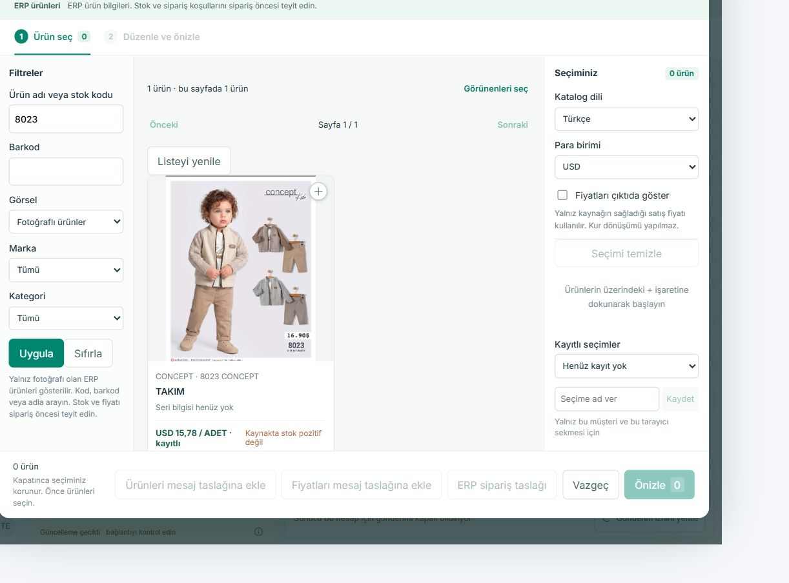

# 8023 CONCEPT özgün fotoğraf — 13 Ekim 2026

Kullanıcının bulanıklık bildirimi üzerine aynı normal TEST kataloğu görünür tarayıcıda açıldı ve `8023` arandı. Önceki özgün fotoğraf düzeltmesi hem güncel kaynakta hem çalışan immutable pakette zaten bulundu; tekrar geliştirilmedi.

| Kontrol | Bu tur gerçek ekran sonucu |
| --- | --- |
| Ürün | 8023 CONCEPT / TAKIM; tek arama sonucu |
| Fotoğraf | Yükleme tamamlandı; doğal 1206×1500 piksel |
| Karttaki gösterim | Yaklaşık 279×279 piksel; mevcut tasarım |
| Kapsam | Fotoğraflı ürünler; sayfa 1/1; seçili ürün0 |
| Fiyat | ERP kayıtlı USD15,78 / ADET; kur dönüşümü yok |

Ekran kanıtı katalog içeriğine kırpılmıştır; müşteri başlığı, telefon, mesajlar ve özel bağlantılar içermez. Fotoğrafın doğal boyutları gerçek DOM'dan salt okunur ölçüldü (`complete=true`). Bu tur dosya indirme/hash karşılaştırması tekrarlanmadı; önceki [10 Ekim özgün JPEG/hash kanıtı](../2026-10-10-catalog-original/README.md) tarihsel olarak korunur. Kullanıcının yeni netlik kabulü hâlâ bekler.

- TEST: <http://127.0.0.1:62700/>. İlk açık sekmedeki bağlantı hatası mevcut “Yeniden dene” düğmesiyle düzeldi; servis restartı veya kaynak düzeltmesi yapılmadı.
- Çalışan uygulama source: `09ca1dac346e42037fd02901baf3240aa6ce6285`.
- Paket manifest SHA256: `9de545b7c06197d628234c67d6ace60780acde4c02685780207abde677cacc4a`.
- Özgün fotoğraf fix source: `222a95f9a63763c39cb18630373a1f27a55c6f65`; aktif pakette görünür kanonik kart `original` ister.
- Bu teslim yalnız taze ekran/metadata ve STATUS kaydıdır. Uygulama kodu, kaynakta bekleyen diğer işler, runtime/config, roller, mesajlaşma, ERP/SQL, LIVE ve main değiştirilmedi. Teknik görüntü doğrulaması insan veya tüm CRM kabulü sayılmaz; kabul edilmiş baseline testleri yeniden çalıştırılmadı.
- GitHub: aktif `codex/crm-agents-on-completion-20261003`, mevcut [PR #3](https://github.com/melihsnyldzz-ui/melisa-crm/pull/3). Bu belge/kanıt commit'i çalışan paket source'u değildir; exact-head CI sonucu [checks](https://github.com/melihsnyldzz-ui/melisa-crm/pull/3/checks) içinde ayrıdır.
