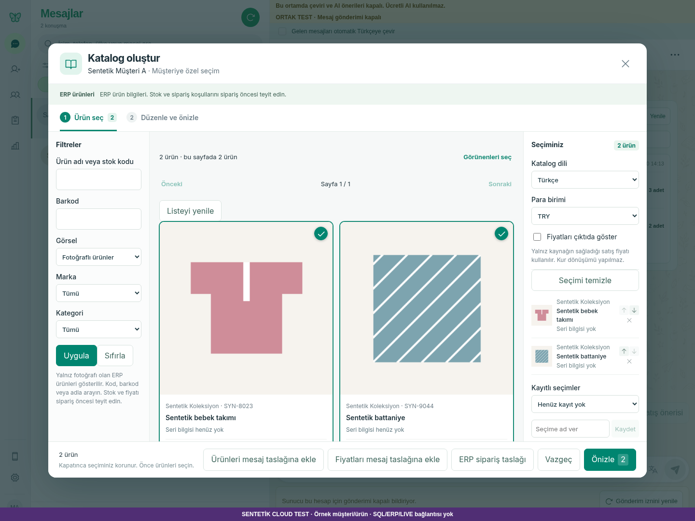
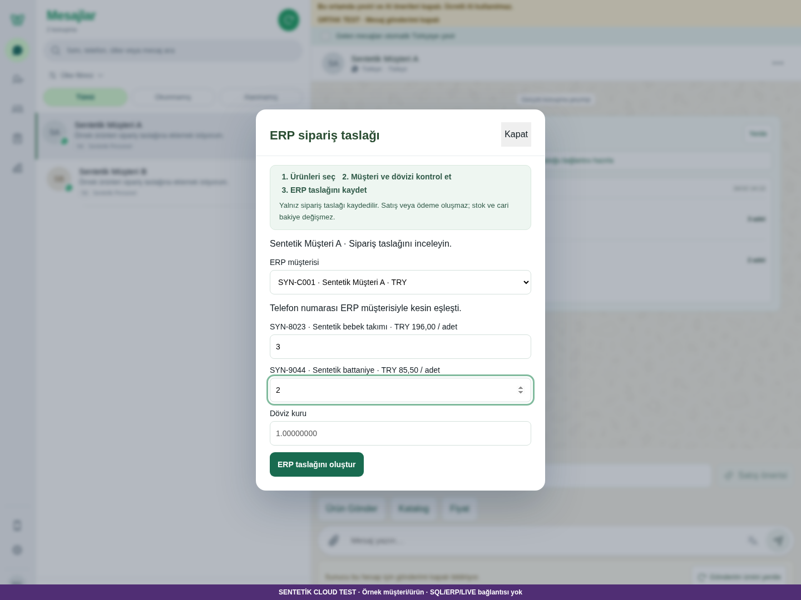
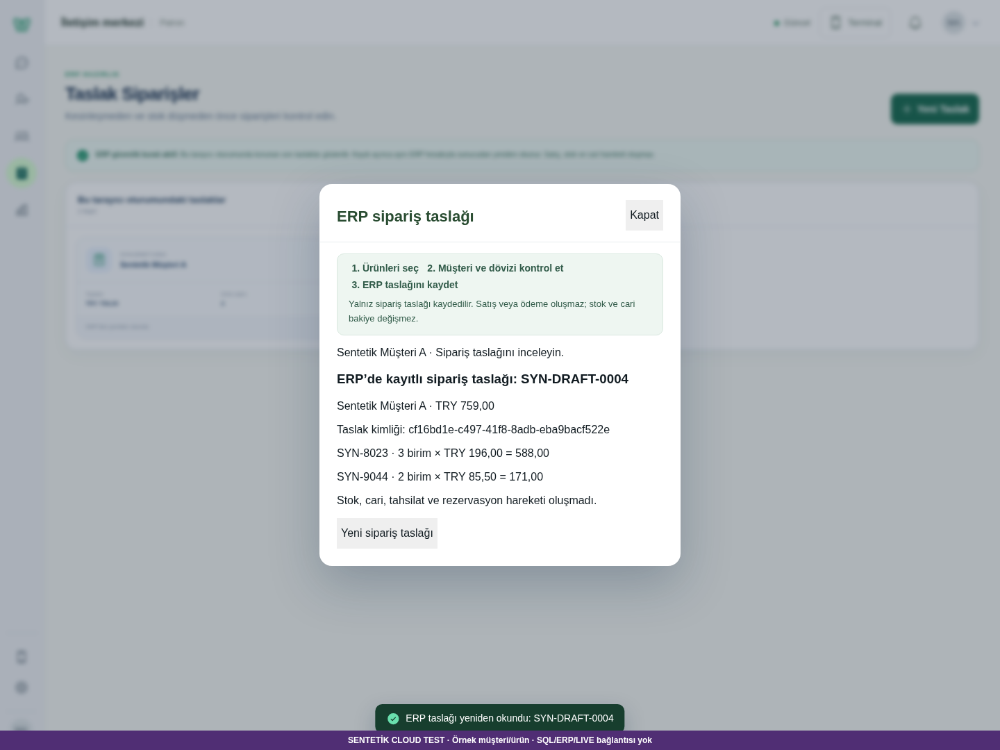
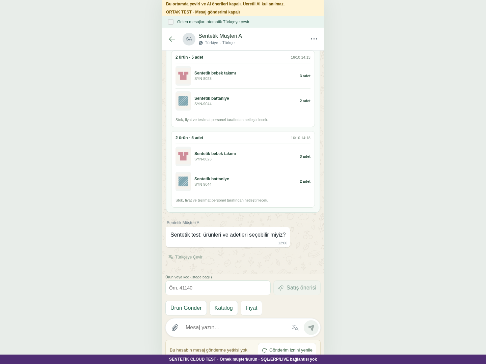

# CRM06 / E02 — çalışan sentetik müşteri → ürün → sipariş akışı

16 Ekim 2026, 14:17–14:18 Türkiye saati. **Cloud sentetik teknik sonuç: PASS. Gerçek personel/cihaz kabulü: BEKLİYOR.**

Kod: `ccc5c937a0b7087623f443c1a2414d5169779eab`; dal `codex/crm-order-flow-browser-20261016`; [PR #17](https://github.com/melihsnyldzz-ui/melisa-crm/pull/17). Teslim head'i bu kaynak kodunu ve izleyen kanıt/durum belgelerini içerir. Güncel CI, [PR Checks](https://github.com/melihsnyldzz-ui/melisa-crm/pull/17/checks) üzerinden tam head ile değerlendirilir.

## Çalışan sonuç

Normal CRM'de Sentetik Müşteri A seçildi. Fotoğraflı katalogdan SYN-8023 ve SYN-9044 seçildi; ürün çıkarma/yeniden ekleme ve sıfır/kesir adet reddi denendi. 3 × 196,00 + 2 × 85,50 = **759,00 TRY** taslak kaydedildi.

- Belge: **SYN-DRAFT-0004**; sipariş UUID: `cf16bd1e-c497-41f8-8adb-eba9bacf522e`.
- Bu işlem için **1 POST ve 3 bağımsız GET**. Önce müşteri B'ye geçildi, sonra listeden A'nın taslağı açıldı; sayfa yenileme ve yeniden giriş sonrası aynı UUID, müşteri, satırlar ve tutar görüldü.
- CRM06 ürün talebi ayrıca normal müşteri katalog bağlantısından kaydedildi: `bb91518b-3d64-432a-92b1-13eb52633e49`, iki ürün/beş adet. Yenilemede aynı kayıt açıldı. Müdür ve atanmış personelin ekranında **aynı ID** doğrulandı; diğer personelde müşteri/talep görünmedi. Kimliksiz ERP okuması 401 döndü.
- 390px tarayıcı görünümünde diyalog ve Kapat düğmesinin gerçek sınırları ölçüldü; taşma yok.

Önceki denemelerin sentetik kayıtları korunur. “Tek kayıt” bu son UUID'nin tek oluşturma isteği/idempotent kaydıdır; toplam journal'ın boş olduğu iddia edilmez.

## Gerçek kod değişikliği

Mevcut PR #3 uygulaması ve PR #16 HTTP akışı taban alındı. Mevcut servis, katalog doğrulaması, native order recovery ve ERP HTTP adapteri yeniden yazılmadı. PR #13 kur hassasiyeti, #14 telefon kopyalama ve #15 JPG çalışmaları tekrarlanmadı.

Normal “Taslak Siparişler” placeholder'ı kaldırıldı. Masaüstü ve mobil menüden son kurtarma kayıtlarına erişilir; aktör ve yetkili konuşma filtresi korunur. Sayfa yenilemede kayıtlı işlem kimliği geri gelir, ERP hesabıyla bağımsız GET ve mevcut exact fiyat/source doğrulaması yapılır. Kayıtlı satırlardan yeni sipariş başlatma hatası taze kataloğa dönüşle giderildi. Gerçek Chromium'da bulunan mobil diyalog taşması düzeltildi. Personel talep satırına aynı kaydı doğrulamaya yarayan ID niteliği eklendi.

## Kontroller ve düzeltilen hatalar

| Kontrol | Sonuç |
| --- | --- |
| Gerçek Chromium / normal React UI | **12/12 PASS** |
| Mevcut offline regresyon | **1280 PASS, 51 platform skip, 0 FAIL** |
| Yeni history + sentetik HTTP/guard | **6 yeni PASS** |
| History ve gerçek dialog hedefi | **7 PASS**; dört dialog kontrolü regresyonla örtüşür |
| Frontend production build | **PASS**; mevcut büyük chunk uyarısı sürer |
| JS syntax | **343 modül PASS**, JSX build ile denetlendi |
| Maskeli secret tarama | Mevcut HEAD geçmişi ve teslim diff'i **0 bulgu** |
| Bağımsız kaynak incelemesi | Açık **P1/P2 yok** |

Tarayıcı console/page exception/normal HTTP hatası/dış origin isteği **0**. React StrictMode veya kapatılan görünüm nedeniyle iptal edilen GET'ler `browser-result.json` içinde açıkça tutulur; bunlar başarı diye gizlenmedi.

İlk turlardaki sentetik telefon biçimi uyuşmazlığı ve Vite dev istemcisinin WebSocket denemesi düzeltildi. Test adımlarındaki asenkron kayıt ve personel kompakt menü varsayımları düzeltildi. Tekrarlanan testlerin giriş limiti korunarak temiz bir sentetik sunucuda son koşum yapıldı. Dış ağ kuralı, API redirect kapatma, issuer logout/restart revocation ve temiz checkout dizin oluşturma bulguları giderildi. Son 12 senaryo hatasız tekrar çalıştı.

## Ekranlar

[390px ekran](07-order-mobile-viewport.png) · [Taslak listesi](05-saved-orders-list.png) · [Yetkisiz personel](12-unrelated-staff-no-customer.png). Tüm 12 ekranın isimleri ve hash'leri [manifest](manifest.json) içinde.

## Ortam, yeniden çalıştırma ve sınırlar

`node scripts/cloud-test/server.mjs --synthetic --port 0` gerçek frontend'i geçici loopback portunda açar. [Runner](../../../../scripts/cloud-test/README.md) ve [Chromium komutu](../../../../scripts/browser-test/README.md) bağımlılıkları ve komutları içerir. Yerel örnek journal'lar gitignore kapsamındaki `work/` altındadır. HTTP/Socket guard dış servisleri ve SQL portlarını engeller; dotenv yüklenmez. Gerçek App/liveApi, CRM06 servis/router ve ERP HTTP adapteri kullanılır; Chatwoot/ERP sınırı sentetik kontrattır. Vite test istemcisi yalnız yerel CSS yükler, ağ soketi açmaz. Ekranda görünür sentetik banner vardır.

Son koşumun port/PID/source kaydı [test-results.json](test-results.json) içindedir. Bu adres kalıcı ortak staging veya kullanıcının kendi bilgisayarında çalışan servis değildir. HTTP testi dosya journal'ının sunucu restart'ında aynı kaydı koruduğunu ayrıca doğrular.

Sipariş listesi **aynı tarayıcı oturumunda yetkili konuşma başına son kurtarma kaydını** gösterir. Sekme kapatma/yeni cihazdan tüm eski siparişleri keşfeden ERP arşiv API'si mevcut sözleşmede yoktur; eklenmedi. Sunucu kayıt doğruluğu her yeniden açmada GET ile doğrulanır. Sentetik `erpPersisted` / `sourceDatabaseVerified` alanları gereken kontratı taklit eder; gerçek ERP/DB bağlantısı kanıtı değildir.

Vega/SQL, LIVE, gerçek müşteri mesajı ve gerçek ticari kayıt kullanılmadı. Kurulu Windows TEST/LIVE commit'i bu görevde doğrulanmadı. CRM06 / E02 / CRM-UA11 gerçek personel ve fiziksel cihaz kabulü açık; **25 toplam /12 tamam /13 kısmi /0 açık** sayımı değişmez. Main merge/tag/release/deploy yapılmadı.

Yayımlanan tarayıcı JSON'undaki 14 sentetik `priceSourceKey` değeri `[synthetic]` olarak maskelendi; ham yerel sonuç değişmedi. Bunlar yalnız örnek fiyat kaynağı kimlikleridir; genel secret sezgisinde eşleştiler. Scanner istisnası eklenmedi veya kural gevşetilmedi. Yetki başlıkları, parolalar ve auth yanıtları kanıta alınmadı.

Makine tarafından okunur kanıt: [tarayıcı sonucu](browser-result.json), [test özeti](test-results.json), [hash manifesti](manifest.json).
