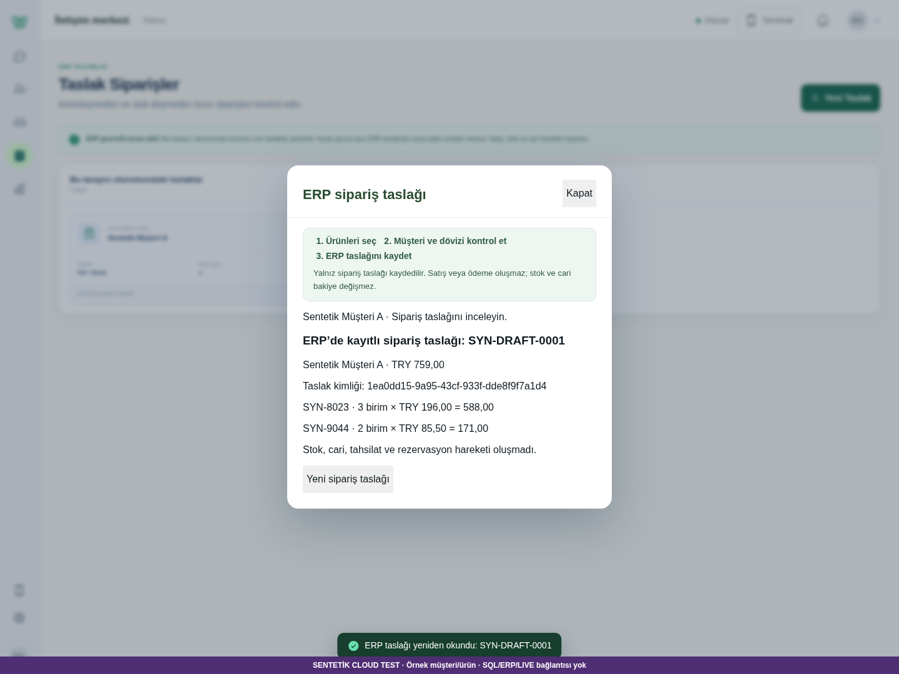
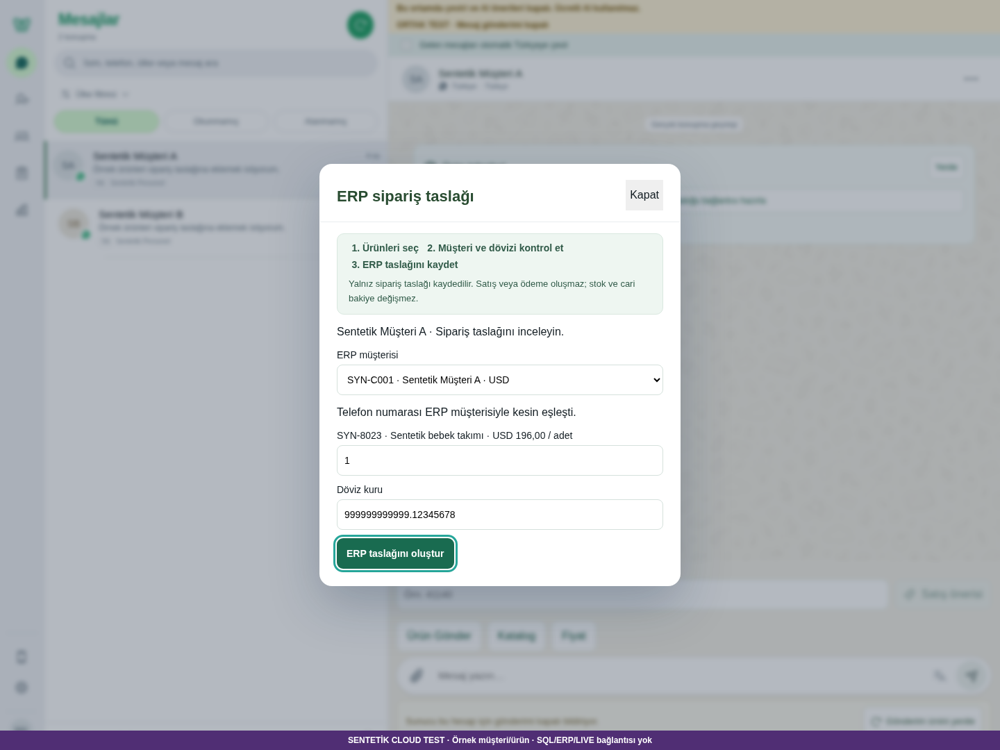
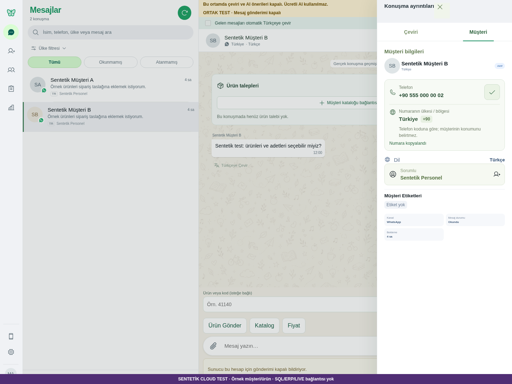
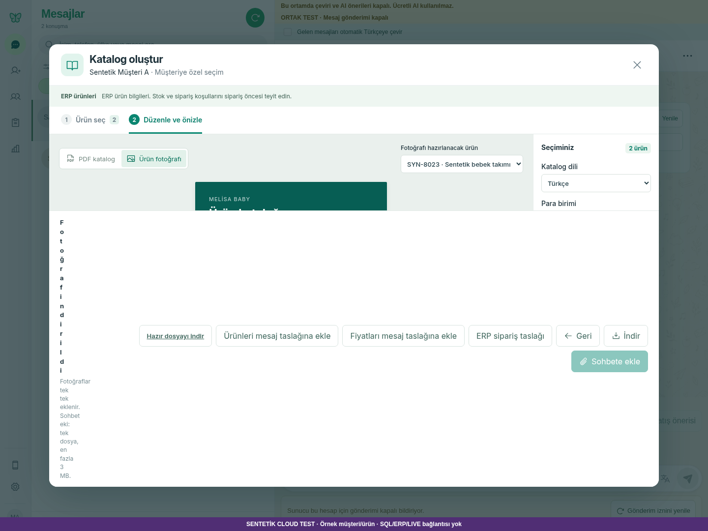

# CRM BULUT — PR13–17 tek aday sürüm

16 Ekim 2026, 16:14–16:19 Türkiye saati. **Birleşik aday teknik doğrulaması PASS. Gerçek personel/fiziksel cihaz kabulü BEKLİYOR.**

## NE DEĞİŞTİ

PR17'nin doğrulanmış `248ab613719727e55af284cb486358624a356d48` sürümü başlangıç alındı. PR13–15'in yalnız eksik kod ve test source commit'leri `cherry-pick -x` ile tek aday dala alındı. PR16 zaten atadaydı; yeniden eklenmedi. Akış yeniden geliştirilmedi; yeni özellik, panel veya sipariş arşivi yok.

| PR | Alınan kaynak | Aday commit'i | İçerik |
| --- | --- | --- | --- |
| [13](https://github.com/melihsnyldzz-ui/melisa-crm/pull/13) | `bbfe346fad03302526b3d22d8de4affa51d77a10` | `7ccaf71` | Kur metni exact8; 16 hedef test |
| [14](https://github.com/melihsnyldzz-ui/melisa-crm/pull/14) | `dd6c00300ff5510c8ad508b0e6e31bb322980483` | `f27cf74` | Müşteri/pano sonuç bağlamı; 18 hedef test |
| [15](https://github.com/melihsnyldzz-ui/melisa-crm/pull/15) | `55300f222626ff280fad7ee7a6c67e2be7a14a08` | `4a0d732` | Seçili kanonik JPG original; 10 hedef test |
| [16](https://github.com/melihsnyldzz-ui/melisa-crm/pull/16) | `eb8b419e08e64e40c97f503db9f9df02c0c28b32` | Atada zaten **bir kez** | Gerçek HTTP müşteri-talep testi |
| [17](https://github.com/melihsnyldzz-ui/melisa-crm/pull/17) | `248ab613719727e55af284cb486358624a356d48` | Doğrudan aday tabanı | Normal taslak, kurtarma, mobil ve 12 senaryo |

PR13–15'in son HEAD'lerindeki eski plan/status-only kayıtları kopyalanmadı; önceki ayrı CI sonuçları yeni adaya atanmadı. Tam eski HEAD/source/yeni SHA eşlemesi [source-mapping.json](source-mapping.json) içindedir.

`ERPOrderDialog.jsx` çatışmasında yalnız PR13'ün mevcut normalizasyon helper'ı ve `onBlur` handler'ı aktarıldı. Bunlar geri çevrildiğinde dosya **PR17 ile bayt düzeyinde aynı**. UUID görünümü, `recoveryOnly/onNewDraft` ve mobil backdrop korunur. PR14/15 uygulama dosyaları ile üç hedef test dosyası özgün kaynaklarla aynıdır. Diğer tüm PR17 uygulama kodu, Cloud fixture servisi ve özgün 12-senaryo script'i değişmedi.

## NEREDEN GÖREBİLİRİM

[Birleşik aday inceleme PR18](https://github.com/melihsnyldzz-ui/melisa-crm/pull/18). Aşağıdaki ekranlar aynı adayın yeni koşumundan alınmıştır; PR17'nin eski ekranları yeniden kullanılmadı.

[Gerçek indirilen örnek JPG](fixes/selected-canonical-original.jpg) · [Mobil taslak ekranı](flow/07-order-mobile-viewport.png) · [Atanmış personel](flow/11-assigned-staff-request.png). Bütün 16 ekran, JPEG ve JSON kanıtları [manifest](manifest.json) ile hash'lenmiştir.

## GERÇEK VERİ DURUMU

Yalnız sentetik Cloud müşteri/ürün/journal ve yerel ephemeral loopback süreçleri kullanıldı. Ayrı worktree, orijinal PR17 checkout'u ve önceki sentetik süreci değiştirmeden doğrulandı. Main, Windows TEST kurulumu, mevcut servisler, Vega/SQL, LIVE, gerçek müşteri mesajı ve güvenlik ayarlarına dokunulmadı. GitHub merge, mevcut PR kapatma veya retarget yok.

Ek tarayıcı kontrolünde clipboard gecikmesi açık bir test bağımlılığıdır. USD fiyat/müşteri cevapları yalnız tarayıcıda biçimlendirilir; kur denemesi sipariş göndermez. JPG için original ve preview, farklı renkli yerel 240px PNG örnekleriyle cevaplanır. Gerçek indirilen **960×1220 JPEG** içinde original pembe piksel **[207,141,153,255]** bulunur; cached mavi preview kullanılmaz. Bu gerçek müşteri fotoğrafının netlik/kalite kabulü değildir. Export sırasında original önbellekten okunabildiği için yeni fotoğraf HTTP isteği çıkmaması normaldir; yeni ağ-fetch iddiası yok.

Paylaşılan ana akış JSON'unda 14 sentetik `priceSourceKey` değeri `[synthetic]` olarak maskelendi; ham yerel çıktı değişmedi. Auth header, parola, token veya cookie kaydedilmedi. Tarayıcı dış origin'e ulaşamaz; fixture runner'ın mevcut offline guard'ı ve bütün güvenlik kapıları korunur.

## GITHUB

- Tek aday dal: `candidate/crm-cloud-pr13-17-20261016`; [PR18](https://github.com/melihsnyldzz-ui/melisa-crm/pull/18), inceleme tabanı PR17 dalı.
- Birleşmiş uygulama commit'i: `4a0d7328af31ac33bd6fbbcf6b78f9daa4e8cdea`.
- Kaynak + ek tekrar çalıştırılabilir tarayıcı kontrolü: `5ecf39fedf960ba090255359ccb4292caa625b00`. Bu iki commit arasında uygulama/fixture/özgün smoke kodu aynıdır; yalnız ek test script'i ve açıklaması eklenmiştir.
- 22 uzak dal ve açık PR kontrol edildi; `candidate/rev3` eski ata/192 commit geride, eşdeğer birleşik aday yoktu. Teslim öncesi aynı uzak kontrol tekrarlandı.
- **Son teslim HEAD'inin CI sonucu [PR18 Checks](https://github.com/melihsnyldzz-ui/melisa-crm/pull/18/checks) ve PR açıklamasında kaydedilir. Ayrı PR'lerin eski yeşili bu adayın sonucu değildir.** Kaynak ve izleyen kanıt commit'i aynı aday dalındadır; kendini içeren hash döngüsü yapılmaz.

## DURUM

| Aynı adayda kontrol | Sonuç |
| --- | --- |
| Tam offline regresyon | **1330 PASS / 51 platform skip / 0 FAIL** |
| PR13 / PR14 / PR15 hedefleri | **16 + 18 + 10 = 44/44 PASS** |
| Hedef + kurtarma/UUID geçmişi | **51/51 PASS**; 44 hedef ve bu 51 kontrol tam regresyonla örtüşür, toplam üzerine eklenmez |
| PR17 özgün Chromium akışı | **Değişmeden 12/12 PASS** |
| Kur/pano/JPG/no-side-effect ek Chromium | **4/4 PASS** |
| Frontend production build | **PASS**; mevcut büyük chunk uyarısı aynı |
| JS syntax | **347 modül PASS**, JSX build ile denetlendi |
| Maskeli secret tarama | Source geçmişi, ek script ve teslim kanıtı: **0 bulgu** |
| Bağımsız source/test incelemesi | Açık **P1/P2 yok** |

Son ana akış siparişi **SYN-DRAFT-0001**, UUID **1ea0dd15-9a95-43cf-933f-dde8f9f7a1d4**, iki satır/3+2 adet/**759,00 TRY**. **1 oluşturma POST'u + aynı UUID'ye 3 ayrı GET**. Müşteri B seçiliyken A taslağı yeniden açıldı; refresh aynı kimlik/müşteri/satır/tutarı korudu. CRM06 ürün talebi aynı ID ile müdür ve atanmış personelde görülür, yanlış personelde yoktur.

Ek kur kontrolünde `999999999999.12345678` ve diğer exact8 değerler bozulmaz, `0002.50 → 2.50000000`, fazla hassasiyet ve exponent sessiz yuvarlanmaz. Pano kontrolü gecikmiş A başarısı ve hatasının B sonucunu bozmadığını gerçek UI'de gösterir. Ek kontrollerde kayıt/talep/mesaj mutasyonu **0**.

Her iki tarayıcı koşumunda console/page/normal HTTP hatası, beklenmeyen istek hatası ve dış origin girişimi **0**. React StrictMode veya kapatılan görünümün beklenen `net::ERR_ABORTED` iptalleri JSON'da korunur; bunlar gizlenmedi.

Tekrar çalıştırma: [özgün 12 senaryo](../../../../scripts/browser-test/README.md), [üç düzeltme ek kontrolü](../../../../scripts/browser-test/combined-fixes.md), [sentetik runner](../../../../scripts/cloud-test/README.md). Makine kanıtı: [ana akış](flow-result.json), [ek kontroller](fixes-result.json), [test özeti](test-results.json), [51 hedef kontrol çıktısı](target-test-results.txt), [kaynak eşlemesi](source-mapping.json).

## SIRADAKİ TEK İŞ

Bu birleşik adayın PR18 üzerinden incelenmesi. **Bu tek bütünleştirme işi teslim edildi; kendiliğinden başka göreve geçilmez.** Gerçek personel/fiziksel cihaz kabulü BEKLİYOR; özgün CRM06/E02/CRM-UA11 kabulleri ve **25/12/13/0** sayımı değişmez. Aynı tarayıcı oturumundaki son kurtarma kaydı sınırı korunur; yeni sipariş arşivi eklenmedi.
